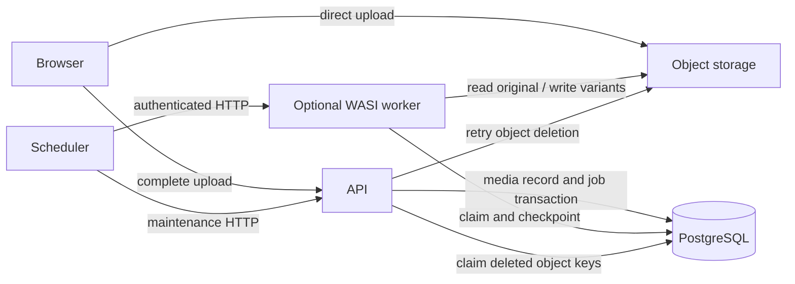

# Optional image optimization

The portfolio always retains the uploaded original. Optimization is disabled by
default and runs in a separate HTTP application, `djmxcreation-media-worker`.
Uploading an image does not wait for this application. Pending, failed, skipped,
or disabled optimization serves the original. The public image component also
falls back to the original if a generated file cannot be loaded.

## Enable it

Apply all migrations, including `V10__CREATE_MEDIA_PROCESSING.sql`, before starting
the API. This migration also provides durable deletion cleanup when optimization
is disabled.

Set these environment variables on the API:

```dotenv
MEDIA_OPTIMIZATION_ENABLED=true
MEDIA_WORKER_URL=http://media-worker.portfolio.internal:9080
MEDIA_PROCESSING_TOKEN=replace-with-a-random-secret-at-least-32-characters-long
```

Give the worker the same `MEDIA_OPTIMIZATION_ENABLED`, `MEDIA_PROCESSING_TOKEN`,
`DATABASE_URL`, and `STORAGE_*` settings as the API. Supply secrets through the
deployment environment. The worker needs database access and object-store
GET/PUT permissions; the API needs DELETE permissions for cleanup. The browser
never receives the processing token.

Build the independent WASI Preview 2 HTTP component:

```bash
cargo build --locked --profile wasi-release --target wasm32-wasip2 \
  -p djmxcreation-media-worker --lib
# target/wasm32-wasip2/wasi-release/djmxcreation_media_worker.wasm
```

For local development, stop an existing stack before restarting with the flag:

```bash
cargo run -p dev-server -- start --mode wasi --with-media-worker --detach
```

Omit
`--with-media-worker` to use originals without starting an optimizer. The admin
project page offers **Optimize images** to queue existing images and retry
failed jobs for that project.

## Durable processing on a serverless host



PostgreSQL stores jobs, checkpoints, retry times, and leases. Upload completion
queues image processing in the same database transaction as the media record.
Each authenticated `POST /internal/media/process-due` to the worker processes
one target width for one image. The response status is `pending`, `ready`,
`skipped`, `cancelled`, `disabled`, or `idle`. Storage failures return HTTP 503
and retain the job for retry. After five unsuccessful claims at one step,
an administrator can retry the failed job.

Configure an external durable HTTP scheduler to invoke this endpoint repeatedly
with header `X-Media-Worker-Key: <secret>`. Keep invoking periodically, including
after temporary HTTP failures or an `idle` response: later uploads may create
new jobs. The admin sends a bounded series of processing requests after an
upload, but closing the browser must not stop production processing. There is
no permanent background loop, PostgreSQL LISTEN connection, or detached task
inside a request handler. HTTP notification is a wakeup; the database remains
the durable source of work.

Independently schedule `POST /internal/media/maintenance` on the API with the
same header. It claims up to 16 due object deletions, stopping between files
after five seconds; individual storage operations have a ten second timeout.
Keep cleanup scheduled
even when the worker is disabled or removed. An external invoker may instead
call the worker directly for processing and the API for cleanup. Do not expose
either endpoint without the secret check; normal media administration endpoints
still require the administrator's OpenID Connect token.

When optimization is disabled, the API still needs `MEDIA_PROCESSING_TOKEN`
if scheduled cleanup must retry deletions after a storage outage.

## Images and limits

Static JPEG, PNG, and WebP are decoded and resized using pure Rust. Integer
Lanczos3 convolution through `fast_image_resize` reduces WASI fuel consumption;
its Rayon thread pool is disabled. Widths are
400, 800, 1600, and up to 2560 pixels, with no enlargement, preserved proportions,
and a 3.5 megapixel cap per generated image (including portrait photographs).
EXIF orientation is applied before resizing. RGB ICC profiles are retained;
unsupported profiles and custom PNG gamma retain the original instead. JPEG
quality 85 with 4:2:0 chroma subsampling is the opaque baseline, encoded with
the pure Rust `jpeg-encoder`; transparency uses PNG. Lossless WebP is attempted
up to 2 megapixels and included only when smaller than that baseline. Larger
variants retain the JPEG/PNG baseline to stay within the serverless fuel budget.
This is not a lossy WebP or AVIF
encoder. Original bytes remain intact; generated images do not copy EXIF data.

Animated images, GIF, AVIF, unsupported formats/profiles, inputs above 32 MiB,
images above 24 megapixels, or dimensions above 12000 pixels keep their original.
Decode allocations are limited to 256 MiB. These are admission bounds, not a
guarantee that every admitted file fits every host's CPU budget. A host timeout
leaves the lease to expire; a later HTTP invocation resumes the current step.
Video files and video transcoding are outside this component's scope.

Public API media objects optionally include `optimization` with `status`,
`reason`, original `width`/`height`, and ready `sources` containing signed URLs,
dimensions, and `mimeType`. Sources become visible only after all required
steps complete. The portfolio selects sizes with `picture` and `srcset`.

## Deletion and interrupted requests

Deleting media or a project removes its public records immediately and cancels
its processing job. Database triggers enqueue object deletion for originals and
all registered variants. Potential output keys are registered before storage
writes, so an interrupted upload can still be cleaned. Processing uses lease
tokens; stale invocations cannot publish variants. A short transaction locks the
media row while writing a variant, preventing publication after its deletion.

Variant cleanup waits until an active lease expires plus a 30 second grace
period, covering interrupted storage writes on the platform's bounded HTTP
runtime. Originals are eligible immediately. Failed storage deletions remain
in the cleanup table with backoff; the maintenance endpoint retries them without
requiring the worker. Do not reuse generated object keys for unrelated content.

## Wasm Cloud Platform

Deploy the component as an HTTP WASI application on
[Wasm Cloud Platform](https://github.com/Djudicael/Wasm-Cloud-Platform). It needs
no subprocess, FFmpeg, threads, or filesystem preopens. Allow outbound network
access to PostgreSQL and S3 in the application's network policy. Resolve
`MEDIA_WORKER_URL` through the platform's application mesh using the actual
application name and namespace. Use `placement.policy = "every_node"` for the
worker when calling it through this node-local mesh. Do not add the optional
worker to the API's required `local_dependencies`: removing it must not prevent
the API from starting. Required services can use the platform's dependency
configuration as appropriate. The deployment must separately arrange the
durable periodic HTTP invocations described above.

Start from [the worker manifest](../deploy/wcp/media-worker.example.toml), adapt
its namespace, allowed networks, storage address, and secret references, then
deploy it with `wasm-ctl deploy --manifest <configured-manifest>`. It declares no
public gateway route; use the internal mesh or configure a protected ingress
for your external scheduler. Configure the API's optional worker URL separately.

The platform must permit ephemeral outbound TCP client binds (`TcpBind` on
port zero) in both runtime and supervisor socket policy. The compatibility test
identified this requirement for the WASI PostgreSQL transport; older platform
revisions that deny it cannot process jobs. Fixed listening ports and destination
CIDRs remain restricted. Use the accompanying runtime/supervisor correction in
the platform checkout before deployment. A portable copy is provided as
[a platform patch](patches/wcp-ephemeral-client-bind.patch); apply it with
`git apply /path/to/wcp-ephemeral-client-bind.patch` from an unpatched platform
checkout. The local checkout used for compatibility testing already contains
this correction.

The compatibility probe in `scripts/wcp-media-probe.rs` uses the platform
checkout's `runtime` and `common` crates. Build it against a platform checkout:

```bash
bash scripts/build-wcp-media-probe.sh /path/to/Wasm-Cloud-Platform
WCP_MEDIA_PROBE=/tmp/wasm-cloud-platform-target/debug/djmx-wcp-media-probe \
  cargo test -p djmxcreation-media-worker --test pipeline -- --nocapture
```

The script uses the platform's pinned toolchain and locked runtime dependencies;
it does not change that checkout. The probe supplies no filesystem preopens and
uses a 10 billion instruction fuel quota and 512 MiB linear-memory limit, matching
the supervisor's admission ceilings. It tests
the component through the actual platform HTTP runtime against PostgreSQL and
RustFS. It does not provision a control plane, microVMs, or a production cluster.
Production quotas must be checked against representative photographs before
deployment; the original-image fallback remains necessary.

## Compatibility validation — 2026-10-27

The HTTP component was exercised against Wasm Cloud Platform revision `e62b0f1`
plus the socket-policy patch above, using its locked Wasmtime 48.0.1 runtime.
The application uses its pinned Rust 1.97.1 toolchain; the compatibility host uses
the platform's pinned Rust 1.98.1 toolchain. Tests used PostgreSQL and RustFS in
Podman, a 10 billion fuel limit, 512 MiB linear memory, fresh WASI instances per
HTTP request, and no filesystem preopens.

| Synthetic PNG input | Completed size steps | Measured processing time per HTTP step |
| --- | --- | --- |
| 6000 × 4000 (24 MP, landscape) | 4 | 0.39–0.47 seconds |
| 4000 × 6000 (24 MP, portrait) | 3; output pixel cap reached | 0.38–0.48 seconds |

These timings exclude cold compilation, container provisioning, and test setup.
They establish compatibility for these fixtures, not capacity guarantees for
every admitted image or a production cluster. Reproduce the larger tests with
`MEDIA_TEST_WIDTH=6000` or `MEDIA_TEST_WIDTH=4000 MEDIA_TEST_HEIGHT=6000` on the
pipeline command above.

The pipeline also verifies unchanged original bytes, decoded variant dimensions,
original fallback while pending or disabled, rejected unauthenticated requests,
lease expiry, rejection of stale writers, deletion during processing, cascading
project deletion, and durable cleanup after a storage outage. Image unit tests
cover proportions, no enlargement, EXIF rotation, and resized transparency.
Browser scenarios exercise responsive sources and original fallback when a
variant returns 404, alongside the existing gallery, mobile, and NSFW scenarios.

Repository checks passed in WSL:

```bash
npm test
npm run build
cargo fmt --all -- --check
cargo check --workspace --all-targets
cargo test --workspace
cargo clippy --workspace --all-targets -- -D warnings
```

The platform checkout also passed its workspace checks and Clippy, all 66 runtime
unit tests, and the focused supervisor ephemeral-bind regression test. No
production deployment or microVM topology was created for this validation.

The npm audits report no vulnerabilities. Cargo audit reports nine advisories
also present in the original lockfile; the new image dependencies do not add a
new advisory. Those existing dependency findings remain a separate maintenance
item and are not suppressed by this feature.
